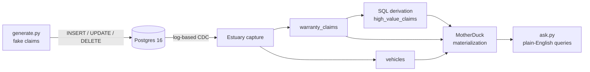

# Real-time warranty claims pipeline with Estuary Flow
 
Postgres → Estuary CDC → SQL transformation → MotherDuck → plain-English queries with Claude.
 
I built this to get a better understanding of Estuary's product. The best way to learn something is to play around with it, so I set up a small real-time pipeline end to end, then broke it on purpose to see how it fails and recovers.
 

 
## What it does
 
- **Source:** Postgres 16 in Docker, with logical replication enabled. A Python generator keeps inserting, updating and deleting fake warranty claims as they move through `submitted → under_review → approved/rejected → paid`.
- **Capture:** Estuary reads every change from the Postgres write-ahead log (WAL) through a replication slot, using a dedicated read-only replication user.
- **Transformation:** a SQL derivation keeps claims of €2,000 or more, adds a `severity` label and extracts the market from the dealer code. It's keyed on `claim_id`, so status updates replace earlier versions instead of duplicating them.
- **Destination:** MotherDuck tables kept in sync by an Estuary materialization.
- **AI layer:** `ask.py` turns a plain-English question into a single read-only DuckDB query with Claude, retries once if the SQL fails, and summarises the result. Anything that isn't one `SELECT` is blocked.
## What I broke, and what happened
 
**Source outage.** I cut Estuary's connection to Postgres for 10 minutes while the generator kept writing. The capture errored and kept retrying, and `pg_replication_slots` showed the slot inactive with retained WAL growing. Postgres was holding every change Estuary hadn't confirmed yet. When I restored the connection, the capture resumed from the slot's position and caught up, with nothing lost or duplicated. A longer outage would have hit the `max_slot_wal_keep_size` cap I set (1GB). That invalidates the slot and means a fresh backfill, but the alternative is a full disk.
 
**Schema change.** I added a `technician_notes` column mid-stream. The Estuary collection picked it up automatically, but the MotherDuck table didn't. The materialization only writes the fields selected when it was last published, so I included the new field and republished. In the meantime the values were already in each row's raw `flow_document` JSON.
 
## What I learned
 
- **Replication slots are what make CDC reliable, and what make it risky.** They guarantee nothing is missed during an outage, but an abandoned slot keeps holding WAL until the disk fills. Monitoring slot lag matters as much as monitoring whether the capture is running.
- **Documents aren't rows.** A collection stores every change as its own document, while the destination merges them by key into one row. Deletes are soft by default, marked `_meta/op = 'd'`. So the counts in Estuary, MotherDuck and Postgres never match exactly, and that's expected.
- **Most of my problems were configuration slips, not product problems.** Estuary's docs were easy to follow. My issues were things like a trailing space in an address or a region label pasted instead of a region code. They're probably the same small things real users run into.
## Troubleshooting log
 
| What I saw | Root cause | Fix |
|---|---|---|
| `password authentication failed` | The password in `DATABASE_URL` didn't match the container's | Built the URL from `${POSTGRES_PASSWORD}` so they can't drift |
| Capture failed: `invalid port ":27093%20%20..."` | Trailing spaces copied with the ngrok address | Typed the address by hand |
| S3 `URL using bad/illegal format` | Region display name entered instead of the code (`eu-north-1`) | Used the code in Estuary and in the MotherDuck secret |
| `flowctl`: source collection not found | Collection names include the source schema (`.../public/warranty_claims`) | Found the name with `flowctl catalog list --collections` |
| `ask.py`: no tables found | Tables were created in schema `public`, not `main` | Set `MOTHERDUCK_SCHEMA=public` |
| More rows in MotherDuck than in Postgres | Soft deletes: deleted rows stay, marked `_meta/op = 'd'` | Filter them out in queries (`ask.py` does this automatically) |
| New column in the collection but not in MotherDuck | Materialization only writes fields selected at its last publish | Included the field and republished |
 
**Bug found:** when the capture failed on the address above, the connector's error message showed the database password in plain text, even though the log line before it masked it. I rotated the password afterwards.
 
## What I'd change next
 
- Move the database to a managed cloud Postgres instead of a local Docker container.
- Set up proper networking (allowlisting Estuary's IPs or an SSH tunnel) instead of ngrok.
- Monitor replication slot lag and `wal_status`, not just whether the capture is running.
## Run it yourself
 
Setup takes about an hour. See **[SETUP.md](SETUP.md)** for the step-by-step guide, including cleanup.
 
```
db/init.sh                     tables, replication user, publication
docker-compose.yml             Postgres 16 with wal_level=logical
generator/generate.py          fake claims: inserts, updates, deletes
estuary/flow.yaml              derivation spec
estuary/high_value_claims.sql  derivation SQL
llm/ask.py                     plain-English queries with Claude
```
 
All data is randomly generated.